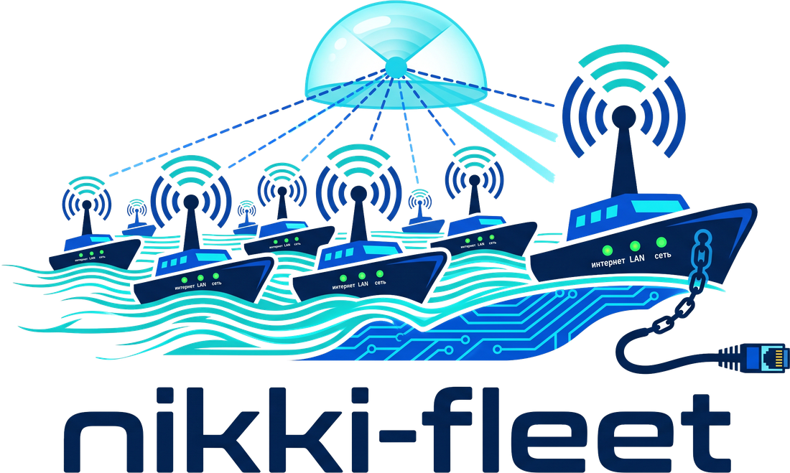

<p align="center"></p>

# nikki-fleet

**Удалённое управление роутерами OpenWrt с [Nikki](https://github.com/nikkinikki-org/OpenWrt-nikki) + mihomo.**
Визуальный конфигуратор прямо в LuCI и веб-панель, к которой роутеры подключаются сами — без белого IP и проброса портов.

[English](README.en.md) · [Архитектура](docs/architecture.md) · [Разработка](docs/development.md)

---

## Что умеет

**Конфигуратор** — один и тот же редактор работает в трёх местах: в LuCI на роутере, в панели и как отдельный HTML-файл.

- Подписки (proxy-providers): ссылки, фильтры, заголовки устройства (User-Agent, x-hwid, x-device-os…) с пресетами, превью узлов с пингом и остатком трафика.
- Правила — плитки с перетаскиванием, rule-providers, проверка «куда пойдёт домен» (в том числе с конкретного устройства).
- Клиенты — правила по IP устройства: «через VPN», «своя нода», «напрямую», «блок», исключения по спискам.
- Группы — состав, фильтры, выбор активной ноды на живом mihomo.
- Работает на телефоне.

**Безопасное сохранение на роутер** — каждое изменение:

1. проверяется командой `mihomo -t` — ошибочный конфиг не попадает на роутер;
2. сохраняется с резервной копией (последние 10 версий);
3. применяется перезапуском Nikki;
4. **откатывается автоматически**, если mihomo не поднялся;
5. при удалённом изменении — откатывается, если после него роутер 3 минуты не может связаться с панелью.

**Прокси-группы, как в дашбордах mihomo** — вкладка «Прокси»: все группы с узлами плитками, текущий выбор и цепочка (Proxy → Best → узел), переключение узла кликом, закрепление узла в url-test/fallback, проверка задержки группы или узла, поиск и сортировка по задержке; подписки — обновить, проверить, остаток трафика.

**Быстрая настройка** — свежий роутер, где Nikki ещё не настроен, получает готовый профиль из шаблона ([templates/starter.yaml](templates/starter.yaml)): достаточно указать название и ссылку подписки (можно несколько). Telegram, YouTube, соцсети, OpenAI/Gemini/Claude, CDN и заблокированные сайты идут через подписку, российские сайты и остальное — напрямую. В панели — кнопка «Быстрая настройка» на «Обзоре», на роутере — `nikki-fleet starter <название> <ссылка>`.

**Фон входа — картинка дня Bing**, как в теме Argon: панель сама скачивает её раз в день и отдаёт из кэша (браузеры к Bing не обращаются). Выключается администратором в «Учётная запись → Администрирование».

**Обновление ядра mihomo и zashboard из панели** — на «Обзоре» в блоке «Компоненты» видно установленные и последние версии. Ядро ставится из официального релиза [MetaCubeX/mihomo](https://github.com/MetaCubeX/mihomo), веб-панель — из [zashboard](https://github.com/Zephyruso/zashboard); если GitHub с роутера недоступен, файлы идут через панель. Рассчитано на маленький флеш: новое ядро распаковывается в оперативную память и проверяется текущим конфигом; на флеше всегда только одна копия — при нехватке места старое ядро перезаписывается на месте с остановкой Nikki на несколько секунд (интернет идёт напрямую). Если новое ядро не поднялось, возвращается прежнее — из копии в памяти или повторной загрузкой. Перед началом проверяются свободные флеш и RAM; если не хватает, обновление не начинается.

**Обновление из панели** — панель видит, что вышла новая версия nikki-fleet, и обновляет роутер кнопкой «Обновить» (пакеты идут с GitHub или через панель, Nikki и профили не трогаются).

**Трафик в реальном времени** — вкладка «Трафик» в панели: скорость загрузки и отдачи с графиком за 3 минуты; через какие узлы, с каких устройств (имена из DHCP) и по каким правилам идёт трафик; таблица соединений с поиском и кнопкой «закрыть соединение».

**Панель** — список роутеров со статусом (модель, OpenWrt, версии, аптайм, трафик, подписки), конфигуратор для каждого роутера, история версий с откатом, резервные копии, логи, совместный доступ (владелец / редактор / просмотр), журнал действий. Роутеры могут принадлежать разным людям: каждый видит только свои и те, к которым ему дали доступ.

## Как это устроено

```
┌──────────── Панель (Docker на VPS) ────────────┐
│  веб-интерфейс · API · история · доступы        │
└──────────────────────▲─────────────────────────┘
                       │ HTTPS, соединение открывает роутер (long-poll)
        ┌──────────────┴──────────────┐
   ┌────┴─────┐                  ┌────┴─────┐
   │ OpenWrt  │                  │ OpenWrt  │   Nikki + mihomo
   │ агент    │                  │ агент    │   + nikki-fleet
   └──────────┘                  └──────────┘   + luci-app-nikki-fleet
```

Роутер сам держит исходящее соединение с панелью, поэтому работает за NAT и CGNAT. Агент выполняет только команды из белого списка (прочитать/записать профиль, перезапустить Nikki, запрос к API mihomo, логи) — произвольные shell-команды он не выполняет.

## Установка

### На роутер — одной командой

Нужен OpenWrt **24.10** или **25.12** с firewall4. По SSH на роутере:

```sh
wget -qO- https://raw.githubusercontent.com/dontbass/nikki-fleet/main/install.sh | sh
```

**Если сайты заблокированы.** Репозиторий Nikki (`nikkinikki.pages.dev`, Cloudflare) из России часто недоступен. Тогда установщик берёт те же официальные пакеты из релиза Nikki на GitHub, а если и GitHub недоступен — через вашу панель: она скачивает файлы сама и кэширует их. Поэтому лучше ставить командой из панели. На роутерах со сжатой флеш-памятью (ubifs, jffs2) учитывается сжатие: mihomo занимает там около 25 МБ вместо 55.

Если Nikki ещё не установлен, скрипт сначала поставит **официальный Nikki** его же скриптами (`feed.sh` и `install.sh` из [nikkinikki-org/OpenWrt-nikki](https://github.com/nikkinikki-org/OpenWrt-nikki)): репозиторий Nikki подключится к opkg/apk, и Nikki будет обновляться штатно. Затем ставятся пакеты nikki-fleet. Сам Nikki при этом не меняется — nikki-fleet ставится рядом как дополнение. Пропустить установку Nikki: `NIKKI=0`.

Свежий Nikki после установки выключен. Он включится, когда вы сохраните первый профиль в конфигураторе («Сохранить как новый профиль»), или вручную: `nikki-fleet enable` (с проверкой — если mihomo не запустится, Nikki снова выключится).

Из панели та же команда идёт с кодом и сразу подключает роутер: `wget -qO- https://ваша-панель/install.sh | sh -s -- КОД`.

Вручную — скачайте `.ipk` (24.10) или `.apk` (25.12) со страницы [Releases](https://github.com/dontbass/nikki-fleet/releases):

```sh
# OpenWrt 24.10
opkg update && opkg install ./nikki-fleet_*.ipk ./luci-app-nikki-fleet_*.ipk ./luci-i18n-nikki-fleet-ru_*.ipk
# OpenWrt 25.12
apk update && apk add --allow-untrusted ./nikki-fleet-*.apk ./luci-app-nikki-fleet-*.apk ./luci-i18n-nikki-fleet-ru-*.apk
```

После установки в LuCI появятся пункты **Службы → Nikki → Конфигуратор** и **Удалённое управление**.

### Панель — одной командой

Нужен VPS с **Ubuntu 24.04 или 26.04** (подойдут и Debian 12/13), домен и A-запись этого домена на IP сервера. На сервере:

```sh
wget -qO- https://raw.githubusercontent.com/dontbass/nikki-fleet/main/install-panel.sh | sudo bash -s -- --domain fleet.example.com
```

Скрипт сам:

- проверит, что домен указывает на этот сервер, и что порты 80/443 свободны;
- скачает панель из последнего релиза и запустит её как службу `nikki-fleet-panel` (systemd, изолированный пользователь);
- поставит [Caddy](https://caddyserver.com) — он выпустит сертификат Let's Encrypt для домена и будет продлевать его автоматически;
- откроет порты 80 и 443 в ufw, если он включён.

Затем откройте `https://fleet.example.com` и создайте учётную запись — она станет администратором.

| Параметр | Назначение |
|---|---|
| `--domain NAME` | домен панели (без него скрипт спросит) |
| `--email ADDRESS` | e-mail для уведомлений Let's Encrypt |
| `--open-registration` | разрешить регистрацию всем (по умолчанию пользователей создаёт админ) |
| `--no-caddy` | без Caddy — если у вас уже есть Nginx Proxy Manager/Traefik: проксируйте на `http://127.0.0.1:8080` |
| `--port N` | локальный порт панели (по умолчанию 8080) |
| `--update` | обновить панель до последнего релиза |
| `--uninstall` | удалить службу (данные сохраняются) |

Обновление — та же команда с `--update`. Настройки — `/etc/nikki-fleet/panel.env`, журнал — `journalctl -u nikki-fleet-panel -f`, данные — `/var/lib/private/nikki-fleet`.

<details><summary>Docker или вручную</summary>

```sh
mkdir nikki-fleet && cd nikki-fleet
curl -fsSLO https://raw.githubusercontent.com/dontbass/nikki-fleet/main/panel/docker-compose.yml
# укажите NF_PUBLIC_URL — адрес, по которому панель доступна снаружи
docker compose up -d
```

Перед контейнером нужен обратный прокси с HTTPS. Без Docker: бинарник `nikki-fleet-panel-linux-*` из релиза, `nikki-fleet-panel -public-url https://fleet.example.com -data /var/lib/nikki-fleet`.

| Переменная | По умолчанию | Назначение |
|---|---|---|
| `NF_PUBLIC_URL` | из запроса | адрес панели для команды подключения |
| `NF_LISTEN` | `:8080` | адрес и порт |
| `NF_DATA` | `./data` | каталог данных |
| `NF_TRUST_PROXY` | `0` | `1`, если панель за обратным прокси |
| `NF_REGISTRATION` | закрыта | `open` — открытая регистрация |

</details>

### Подключить роутер

1. В панели: **Подключить роутер** → скопируйте команду.
2. На роутере по SSH: `wget -qO- https://ваша-панель/install.sh | sh -s -- КОД` — поставит Nikki (если его нет), nikki-fleet и подключит роутер.

Или в LuCI: **Nikki → Удалённое управление** → адрес панели и код. Или в консоли: `nikki-fleet enroll https://ваша-панель КОД`.

## Команды на роутере

```text
nikki-fleet status --full            статус роутера, Nikki и mihomo (JSON)
nikki-fleet profiles                 профили и активный профиль
nikki-fleet test config.yaml         проверить конфиг mihomo -t
nikki-fleet write main.yaml new.yaml безопасно записать профиль (проверка, копия, перезапуск, откат)
nikki-fleet backups main.yaml        резервные копии профиля
nikki-fleet restore main.yaml <id>   восстановить копию
nikki-fleet enable | disable         включить Nikki (с проверкой) или выключить
nikki-fleet enroll <url> <код>       подключить к панели
nikki-fleet unenroll                 отключить от панели
nikki-fleet doctor                   почему роутер не на связи с панелью: служба, лог, DNS, доступ к панели
nikki-fleet update                   обновить пакеты nikki-fleet (в фоне, журнал — /tmp/nikki-fleet-update.log)
nikki-fleet starter <имя> <ссылка>   рабочий профиль из шаблона с одной подпиской, сразу активный
nikki-fleet mihomo-update [vX.Y.Z]   обновить ядро mihomo (по умолчанию — последний релиз)
nikki-fleet ui-update                установить или обновить zashboard
```

## Статус

Ранняя версия (0.1). Проверено: панель, агент и библиотека работают с настоящим mihomo, включая проверку, откат и автооткат при потере связи с панелью. Пакеты собираются CI под 24.10 и 25.12. Отзывы о работе на реальном железе — в [Issues](https://github.com/dontbass/nikki-fleet/issues).

Важно: если активный профиль Nikki — подписка с настройкой «предпочитать удалённую», при обновлении подписки Nikki перезапишет правки. Конфигуратор предложит сохранить профиль как файл и сделать его активным.

## Лицензия

GPL-3.0-or-later. Проект использует [Nikki](https://github.com/nikkinikki-org/OpenWrt-nikki) (GPL-3.0), [js-yaml](https://github.com/nodeca/js-yaml) (MIT) и шрифт флагов [Twemoji Country Flags](https://github.com/talkjs/country-flag-emoji-polyfill) (графика [Twemoji](https://github.com/twitter/twemoji), CC-BY 4.0) — чтобы флаги стран были видны и в Windows.
